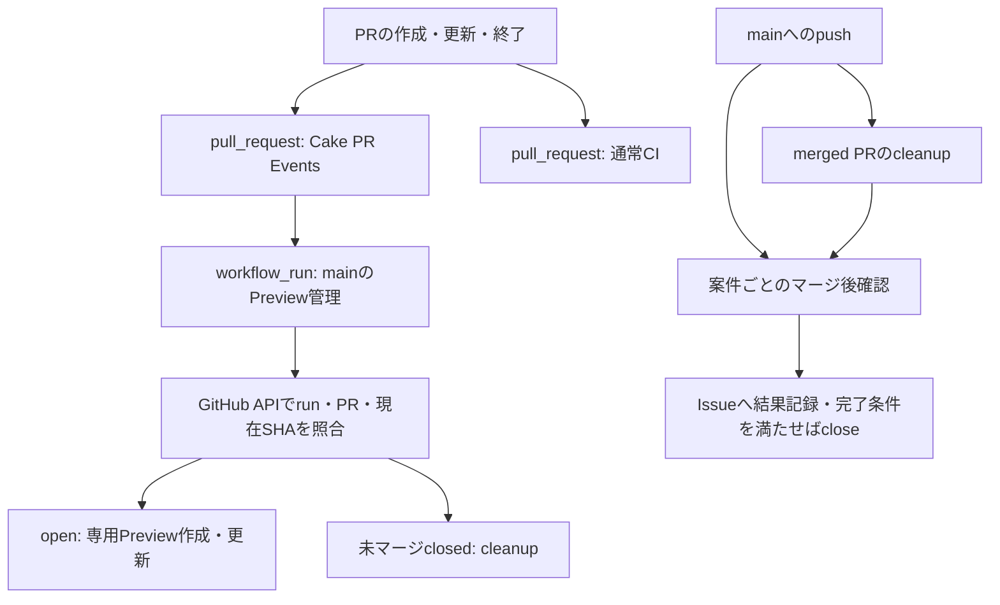

# Actionsのイベントと資格情報

Cakeは、PRの変更を扱うWorkflowと、provider資格情報を使うmainの管理Workflowを分ける。
`pull_request_target`は使用しない。
通常のPR作成・更新からPreviewの管理、merge後の確認・Issue更新までを自動化する。

## イベントと実行コード

| 起点 | 受付・検証 | mainで行う処理 |
| --- | --- | --- |
| PRのopened・synchronize・reopened | `pr-events.yml`の`Cake PR Events`が`pull_request`を受け付ける。通常CIは別の`ci.yml`でPRの変更を検証する | `preview.yml`の`workflow_run`が通知元と現在PRをAPI照合し、専用Preview・DBを作成／更新する |
| PRの未マージclosed | 同じPR受付Workflowが完了する | `preview.yml`の`workflow_run`がclosed状態を照合して専用資源をcleanupする |
| mainへのpush | pushへ含まれるcommitとmerged PRをGitHub APIで照合する | `preview.yml`がmerged PRの専用資源をcleanupし、`post-merge.yml`が案件ごとに稼働確認・結果記録・Issue更新を行う |
| 手動の正式QA・状態確認・再確認 | main上の`workflow_dispatch`と必須inputを照合する | 既存のCLI・正式receipt・remote proofを使う |



PR受付ではcheckout・provider資格情報・artifactの受渡しを行わない。
main側は登録Workflow・通知元runのrepository、実行世代・結果、対象PRの所属・branch・現在HEAD・状態をGitHub APIで検査する。
不一致・不完全な一覧・曖昧な関連・古いSHAではproviderへ書き込まない。
PRから渡されたスクリプトや成果物を管理資格情報付きで実行しない。

`preview.yml`はprovider資格情報を持たないprepareで対象PRを確定し、PRごとのmatrix jobへ渡す。
手動操作・受付後の管理・main push cleanup・正式QAは、job単位の`cake-preview-<PR番号>` concurrencyを共用する。
push全体を同じconcurrencyへまとめないため、別PRのmerge通知を一つの待機枠の置換で失わない。
previewとpost-mergeはいずれも、1 pushのmerged PRが10件を超える場合はprepareで停止する。

`pull_request`は、PRにmerge conflictがあると起動しない場合がある。
この場合は受付と後続の自動Preview管理も起動しないため、競合を解消してPRへpushし直す。
競合があるままPRを未マージcloseした場合は、自動cleanupの起動を前提にせず、
削除対象と影響が承認された範囲で既存の`npm run qa:release -- --pr <閉じたPR番号>`を使う。
処理の未起動を成功と扱わず、正式receiptとproviderの資源不在まで確認する。

merge後のcleanupはjob `preview-cleanup-<PR番号>`で実行し、各PRの`cake-preview/v1` payloadを、
`cake-preview/v1 PR <PR番号>`のnotice titleで公開する。
手動dispatchとPR受付後の単一処理は、既存の`cake-preview-receipt/v1` titleを使う。
案件確認は管理run・job・CheckRun・noticeの来歴と、PR head SHA・merge SHA・control SHAを区別して照合する。
cleanupは正式receiptだけで完了とせず、対象IDの直接GETとprovider一覧で資源の不在を確認する。

`post-merge.yml`のprepareはPR番号とIssue番号の組を確定し、verifyとpublishへ渡す。
検証artifactの名前は`post-merge-<run ID>-<attempt>-<PR番号>`とし、受信側でも同じrun・attempt・PRを再照合する。
publishは同run内の同時実行を1件に制限し、Issue単位のconcurrencyでrunをまたぐ固定コメント更新も直列化する。

## main限定Environment

provider資格情報の保存先はGitHub Environment `cake-automation`とする。
通常のRepository Secretsに同じ値を残すと、同repositoryのPRがWorkflowを変更して参照できるため、分離したことにならない。

Environmentを使うのは、次のprovider管理・正式QAのjobである。

- `preview.yml`のPreview管理と正式ブラウザ検証。
- `staging.yml`の常設Preview。
- `deployment-retention.yml`のDeployment保持。
- `post-merge.yml`のprovider稼働確認。

PR受付・通常CI・Issue更新だけのjobにはprovider資格情報を渡さない。
GitHub権限は各jobに必要な範囲へ限定し、provider資格情報は運用stepだけの環境変数で渡す。
Environment指定を追加しても、PRを操作するGit/ghの子プロセスへprovider資格情報を渡してよいことにはならない。

### Environmentの設定

Repository管理権限を持つ担当者が、Cakeの **Settings → Environments** で設定する。
既存の`Preview`・`Production` EnvironmentやVercel側の設定を置き換えない。

1. Environment `cake-automation`を作成する。
2. **Deployment branches and tags** を **Selected branches and tags** にし、branchの`main`だけを登録する。
   `codex/*`、`refs/pull/*/merge`、tag、すべてのbranchを許可しない。
3. 自動処理を維持するため、**Required reviewers** や待機時間は設定しない。
4. **Environment secrets** に`VERCEL_TOKEN`・`NEON_API_KEY`を登録する。
   所有者が保管している有効な値を使用し、対象project/teamへの権限を維持する。
5. 同名のRepository Secretsと、同じ値を公開するOrganization Secretsの適用が残っていないことを確認する。

GitHubは保存済みsecretの平文を再取得するAPIを提供しない。
登録元が手元にない場合は、所有者が正規のprovider管理画面で確認・再発行する。
値をチャット・Issue・PR・ログ・引数・Git・環境ファイルへ出したり、別環境から持ち込んだりしない。
設定できない権限や不足した資格情報は、未完了の工程として記録する。
Environmentと必要なsecretsが未準備なら、新しいmain側provider jobは成功しない。
コード変更と設定の完了を分けて報告し、切替済みとして扱わない。

設定の確認はsecretの名前とEnvironmentの制限だけを対象にできる。
既存本人認証済みのghを使う場合は、Git/ghへprovider資格情報を渡さない。

```bash
gh api repos/tyask/Cake/environments/cake-automation \
  --jq '{name,deployment_branch_policy,protection_rules}'
gh api repos/tyask/Cake/environments/cake-automation/deployment-branch-policies \
  --jq '.branch_policies[] | {name,type}'
gh secret list --repo tyask/Cake --env cake-automation
gh secret list --repo tyask/Cake
```

secret一覧は値を表示しない。名前の存在だけで認証成功とは扱わず、main側の正式実行でproviderの所属と実際の権限を確認する。
権限不足で設定や名前を読めない場合も、設定済みと推測しない。

## 切替と初回確認

Workflowの変更はPRがmainへ入るまで、新しいmain管理経路として実行できない。
移行するPRのローカル検証・別Agentレビュー・CI・Preview・正式QAは、切替前の信頼済みmainの経路で揃える。
新経路の自動起動を、fixtureテストや旧mainの成功で実証済みとは報告しない。

1. `cake-automation`のbranch制限とEnvironment secretsを準備する。
2. 移行PRの最終SHAで所定の検証を完了し、既存のprovider処理が終了したことを確認する。
3. 切替対象のRepository Secretsを削除し、旧mainの資格情報を使う新しい操作を開始しない。
   この切替期間は旧main側のprovider操作を実行できないため、長時間放置しない。
4. 利用者がPRをmergeする。Agentが独断でmergeしない。
5. main pushのcleanup・案件確認・常設PreviewとCI、Productionの対象SHAを確認する。
   cleanupの正式receipt・対象IDの直接GET不在・provider一覧の照合、Issueへの結果記録まで確認する。
6. 以後の通常PRで、`Cake PR Events`からmainの`workflow_run`が自動起動し、現在HEADのPreviewを管理できることを確認する。
   未マージcloseの検証は、対象PRと削除影響が承認された範囲で行う。

失敗した場合は、失敗したrun・PR・SHA・未完了の設定と資源を記録する。
Repository Secretsの無条件な復元、保護の解除、盲目的な再deploy・再削除で迂回しない。
対象資源を照合し、承認済みの範囲で既存のmain dispatchから状態確認・再確認を行う。

## ランタイムと関連手順

`ubuntu-latest`は継続して使う。runnerのUbuntu版移行noticeは、Node.jsの版と分けて扱う。
アプリ・検証コマンドのNode版は`.node-version`、各公式Action自体のランタイムはそのActionの`action.yml`で決まる。
artifactのupload・downloadはNode.js 24対応の公式commitへ固定し、マージ後結果の同一run・attempt・PRへの結び付けを維持する。

- [開発・QA運用手順](development-workflow.md)
- [開発・PR操作のコマンド](development-commands.md)
- [GitHub: workflow_run](https://docs.github.com/en/actions/reference/workflows-and-actions/events-that-trigger-workflows#workflow_run)
- [GitHub: Environmentsとbranch制限](https://docs.github.com/en/actions/reference/workflows-and-actions/deployments-and-environments)
